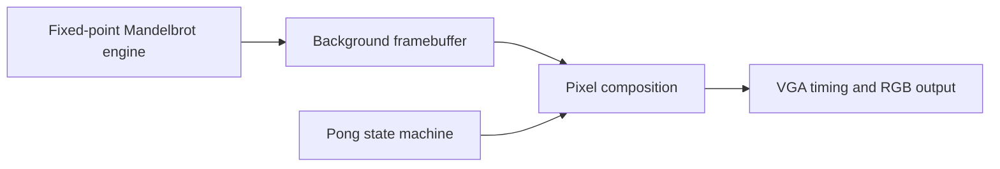

# FPGA Pong with a hardware-computed Mandelbrot background

Pong implemented in **VHDL on a PYNQ-Z2 FPGA**, combining game logic, VGA timing, a framebuffer, and a fixed-point Mandelbrot engine. The background is computed by the circuit, not loaded as a decorative image.

[▶ Watch the Pong logic presentation (1:37)](https://github.com/ri-ru/DSD/raw/refs/heads/main/media/pong-logic.mp4) · [Original presentation](<recovered/dsd_ill/Slides and video/Final presentation.pptx>)

## The design

The Mandelbrot datapath iterates complex coordinates in **Q3.15 fixed-point arithmetic**, stopping on escape or at 100 iterations. Iteration counts feed the background memory; the game circuitry overlays the ball and paddle as the VGA controller scans the display. The selected parameter package specifies a **1024 × 768** display.

The engineering problem is coordinating a variable-work fractal calculation with continuous display timing and frame-synchronous game updates.

## Start with the implementation

| Component | Source |
|---|---|
| Mandelbrot arithmetic and escape test | [mandelbrot.vhdl](<recovered/dsd_ill/FINAL FILES/mandelbrot.vhdl>) |
| Ball, paddle, and game state | [pong_fsm.vhd](<recovered/dsd_ill/FINAL FILES/pong_fsm.vhd>) |
| VGA scan and synchronization | [vga_controller.vhd](<recovered/dsd_ill/FINAL FILES/vga_controller.vhd>) |
| Framebuffer and game/background composition | [mandelbrot_top.vhdl](<recovered/dsd_ill/FINAL FILES/mandelbrot_top.vhdl>) |
| Timing, geometry, and fixed-point parameters | [dsd_prj_pkg.vhdl](<recovered/dsd_ill/FINAL FILES/dsd_prj_pkg.vhdl>) |

A [Mandelbrot testbench and rendering tools](<recovered/dsd_ill/FINAL FILES/lab08_mandelbrot_handout/lab/src>) and the [Vivado project/IP configuration](<recovered/dsd_ill/FINAL FILES/lab81/project_lab8_mandelbrot>) are included.

## Open the hardware project

The project files target **Vivado 2020.2** and **xc7z020clg400-1**. Open the supplied Vivado project, relocate historical source paths if needed, and regenerate IP outputs before synthesis and programming.

[Design and recording provenance](docs/recovery.md) documents the preserved artifacts, source checks, and hardware-build status. Earlier source variants and the original recordings remain available under [recovered/](recovered/).

Developed with teammates. Original presentation credits are retained in the [provenance notes](docs/recovery.md).
