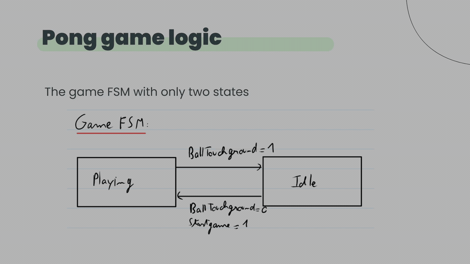

**[▶ Watch the original video — Pong logic (1:37)](https://github.com/ri-ru/DSD/raw/refs/heads/main/media/pong-logic.mp4)**

# DSD — FPGA Pong with a Mandelbrot background

EPFL Digital System Design project for the **PYNQ-Z2 FPGA board**: VGA output, framebuffer memory, Pong game logic, and a Mandelbrot background, written in VHDL.

The original GitHub files are preserved. Additional code and recordings were recovered from `Desktop/epfl/ma1/DSD/dsd_ill`. These are recovered project materials, **not a verified final submission**.

## Code

- [Final VHDL files](<recovered/dsd_ill/FINAL FILES>): package, VGA controller, Pong state machine, Mandelbrot engine, and top-level integration.
- [Pong top level](recovered/dsd_ill/pong_top.vhdl) and [Pong lab sources](<recovered/dsd_ill/lab07_pong_handout/lab/src>).
- [Final Vivado project and IP configuration](<recovered/dsd_ill/FINAL FILES/lab81/project_lab8_mandelbrot>) and [Mandelbrot sources/testbench](<recovered/dsd_ill/FINAL FILES/lab08_mandelbrot_handout/lab/src>).
- Existing [Mandelbrot project](lab), [memory/framebuffer project](lab6_mem), and [memory project Tcl](lab6_memory.tcl).

Earlier local source variants and team backups are preserved under [recovered](recovered); the manifest identifies their original locations.

## Original video and audio

The original recordings are preserved without editing or re-encoding. The featured video above is an MP4 container copy with identical original video and audio streams; its animated thumbnail previews six seconds of the recording.

| Recording | Duration | File |
| --- | --- | --- |
| Introduction — Max | 0:37 | [Original video](<recovered/dsd_ill/Slides and video/Audio + Video Max/Introduction Max.mkv>) |
| Pong logic — Max | 1:37 | [Original video](<recovered/dsd_ill/Slides and video/Audio + Video Max/Pong Logic Max.mkv>) |
| Conclusion — Max | 0:39 | [Original video](<recovered/dsd_ill/Slides and video/Audio + Video Max/Conclusion Max.mkv>) |
| Memory — Dimitri | 1:00 | [Original audio](<recovered/dsd_ill/Slides and video/Audio - DIMITRI/Memory recording - Dimitri.m4a>) |
| Mandelbrot — Dimitri | 1:26 | [Original audio](<recovered/dsd_ill/Slides and video/Audio - DIMITRI/Mandelbrot recording - Dimitri.m4a>) |
| Missing part — Max | 0:14 | [Original audio](<recovered/dsd_ill/Slides and video/Audio + Video Max/missing part DSD Max.mp3>) |

Download the MKV recordings from GitHub and open them in a compatible player. No assembled final submission video has been identified.

The [original final presentation](<recovered/dsd_ill/Slides and video/Final presentation.pptx>) and [presentation structure](<recovered/dsd_ill/Slides and video/Presentation structure.docx>) are included too.

## Recovery and verification

See [recovery notes](docs/recovery.md) and the [SHA-256 file manifest](docs/recovery-manifest.json) for provenance, exclusions, and any pending cloud-only files.

The recovered project records Vivado **2020.2** and FPGA part **`xc7z020clg400-1`**. Original project files retain historical local paths; opening them may require relocating source references and regenerating IP outputs. This is an archival upload, not a newly verified FPGA build.
